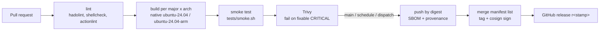

# Release cycle

The image follows upstream PostgreSQL. This repository adds a predictable rebuild
cadence, immutable tags and a deliberate process for adopting new majors.

## Upstream rhythm we track

| Event | Upstream cadence | What we do |
|---|---|---|
| Major release (18, 19, ...) | Once a year, September/October; 5 years of support | Build it as `preview` from beta/RC. Promote to `stable` at **x.1 or x.2** (around 2–5 months after GA), once pgvector, ParadeDB `pg_search` and the PGDG extensions support it and the k8s check passes |
| Minor release (18.6 -> 18.7) | Quarterly, second Thursday of Feb/May/Aug/Nov, plus out-of-cycle security releases | Renovate opens a PR within a week (base tag + digest in `versions.json`). Merge after CI is green, deploy within **2 weeks**, or **48 h** for security releases |
| Debian / base-image security fixes | Continuous | Weekly rebuild (Monday 04:17 UTC) publishes a new dated tag on the same minor |
| pgvector release | Irregular | Renovate PR. Read the changelog: index-format changes need `REINDEX` |
| pg_search release | Frequent (ParadeDB ships often) | Renovate PR, never automerged. Read the release notes: query syntax and index format change between releases |
| Major EOL | 5 years after GA (17: 2029-11, 18: 2030-11) | Remove the major from `versions.json` once no deployment uses it, and at the latest at EOL |

Status values in `versions.json`:

- `stable`: the major we deploy. `default` points to it and gets `latest`.
- `maintenance`: still built and patched (for example 17 until existing deployments are migrated), but not for new deployments.
- `preview`: beta/RC or a fresh GA. CI failures do not block releases. Never deploy it to production.

## Tags

Every publishing run gets a UTC timestamp `STAMP` (`YYYYMMDDHHMM`) and pushes one signed multi-arch manifest (amd64 + arm64) per major:

| Tag | Example | Mutable | Use |
|---|---|---|---|
| `<minor>-<stamp>` | `18.6-202611031200` | no | **deployments** (compose, ImageCatalog) |
| `<minor>` | `18.6` | yes | latest build of a minor |
| `<major>` | `18` | yes | latest build of a major (stable/maintenance only) |
| `latest` | | yes | default stable major |
| `<major>-preview` | `19-preview` | yes | preview majors only |

Deployments pin the immutable tag (or `@sha256:` digest). Floating tags exist for local work and quick tests.

Each run also creates a GitHub release `r<stamp>` listing tags, digests, base images and the pgvector version. The exact package versions in every image are in `/usr/share/evilflowers/manifest.txt`.

## Pipeline

- **Pull requests** build and test every major on both architectures. Nothing is pushed.
- **Merging to `main`** is the release: the same pipeline publishes the images. There is no separate release branch; `main` must always be deployable.
- **Weekly schedule** rebuilds `main` unchanged, which picks up Debian security updates and new PGDG extension builds.
- **`k8s-compat`** (weekly and on relevant PRs) deploys the default major with CloudNativePG on kind.

All tools are open source: Docker Buildx/BuildKit, Trivy, cosign/Sigstore, hadolint, ShellCheck, actionlint, Renovate, kind, CloudNativePG. GitHub Actions and GHCR host the pipeline.

## Adopting changes in a deployment (adaptation)

1. **Minor release or rebuild.** Take the new immutable tag from the GitHub release, set `POSTGRES_IMAGE_TAG` in the deployment's `.env`, then run `docker compose up -d db`. A minor update only restarts the server (about 10–30 s of downtime). Poolers reconnect on their own. Check the logs and `SELECT version();`.
2. **pgvector / pg_search update.** Same as a minor update, then run `ALTER EXTENSION vector UPDATE;` (or `pg_search`) in each database that uses it. Run `REINDEX` only when the changelog asks for it.
3. **Major upgrade.** Plan it as a change with a maintenance window. Follow [upgrade-17-to-18.md](upgrade-17-to-18.md) as the template. Rehearse on a copy of the data first.
4. **Rollback.** Before step 1, note the previous tag. A minor rollback is just the old tag, because minors share the on-disk format. A major rollback means switching back to the old volume, which the upgrade procedure keeps untouched.

Recommended rhythm: one maintenance slot per month (first Tuesday) for minors and rebuilds, plus ad-hoc slots for security releases.

## Adding a new major (checklist)

1. Add `"<N>": {"base": "postgres:<N>rc1-trixie@sha256:…", "status": "preview", "pg_search": false}` to `versions.json` and add `conf/version/<N>.conf`.
2. Watch the preview builds. When GA ships, switch to `postgres:<N>.0-trixie@…` by hand. Renovate deliberately leaves preview tags alone. Drop `"pg_search": false` once the ParadeDB release has a `postgresql-<N>-pg-search_…-trixie` package.
3. At x.1 or x.2, and only with `pg_search` included: set `status` to `stable`, move `default`, set the previous major to `maintenance`, and add the major to `k8s/cnpg/image-catalog.yaml`.
4. Upgrade the deployments, then drop the oldest major.
